# laozu-solver-next · 架构设计文档

> **项目定位**：《我要当老祖》法宝背包摆盘优化器（重写版）
> **核心策略**：计算内核以觉醒版（`laozu-solver-juexing`）为准（仅修正觉醒归属），UI/交互对齐原版（`laozu-solver`），工程结构按可维护性重新拆分
> **技术栈**：Vue 3 + TypeScript + Vite + Pinia + Web Worker → GitHub Pages 静态托管
> **读者画像**：后端开发者（Java 为主），无前端经验 —— 本文档按后端分层思维组织

---

## 一、设计目标与关键决策

### 1.1 目标

| 目标 | 说明 | 来源依据 |
|---|---|---|
| 计算正确性 | 退火求解 + 觉醒 1~5 级计算，与觉醒版一致；**唯一修正：觉醒按副本建模**（见 ADR-8） | 觉醒版 `solver-worker.js` |
| 全自动截图识别 | 上传/粘贴截图 → 自动定位 6×7 网格 → 自动识别，无需手动框选 | 原版 fit Worker（觉醒版已砍掉，`WORKER_SRC:""`） |
| 实时摆盘 | 求解中实时刷新最优解、里程碑回放、多视图得分对比 | 原版 `onProgress` + 四视图 |
| 长老信息管理 | 长老是否拥有/星级/觉醒独立管理（账号级，本地存储），求解/识别/UI 共用单一数据源 | ★ 新增需求（两版原有缓存但无独立管理） |
| 多维筛选 | 法宝目录支持元素/形态/占格数/品阶多维筛选；红装直接显示绑定长老名 | ★ 新增需求（原版仅支持元素筛选） |
| 可维护性 | 核心逻辑与 UI 解耦，纯 TS 模块可在 Node 下单测 | 两版均为单文件巨石，难维护 |
| 静态部署 | GitHub Pages，纯前端无服务端，数据存 localStorage | 两版现状 |

### 1.2 关键决策记录（ADR）

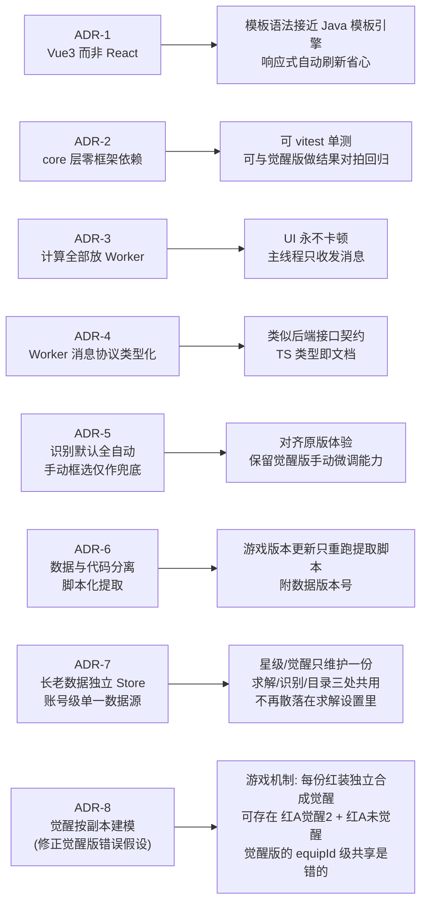

---

## 二、总体架构

### 2.1 分层架构（对照后端分层）

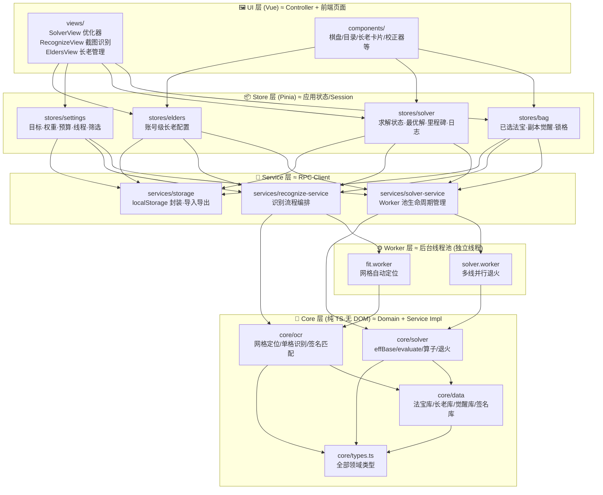

**核心原则：依赖单向向下，core 层不知道 Worker 存在，Worker 不知道 Vue 存在。**
这样 core 层可以直接被 vitest 在 Node 环境跑单测（像 Java 里对 service 层写 JUnit）。
（`SV1 --> K1`：主线程 `effBase` 预计算有效三围时直接调用 core，不经 Worker。）

### 2.2 为什么计算要放 Worker

退火求解是 CPU 密集循环（60 秒预算内跑数百万次迭代）。若在主线程执行，页面完全冻结。两版原作都这么做了，我们沿用，并且**把「网格自动定位」这种几百毫秒的图像扫描也放进 fit.worker**，保证手机端流畅。

---

## 三、文件结构

```
laozu-solver-next/
├── .github/
│   └── workflows/
│       └── deploy.yml              # GitHub Actions: push main → build → 部署 Pages
├── public/
│   └── favicon.svg
├── scripts/
│   └── extract-data.mjs            # ★ 从觉醒版源码提取 DB/ELDER_MAP/AWAKEN_DB/OCR_DATA → core/data
├── index.html                      # Vite 入口 HTML（仅挂载点，无业务代码）
├── package.json
├── tsconfig.json
├── vite.config.ts                  # base='/仓库名/'（Pages 子路径）+ worker 配置
├── README.md
│
├── src/
│   ├── main.ts                     # createApp + pinia + router
│   ├── App.vue                     # 顶栏 + 三个页签 + <router-view>
│   │
│   ├── core/                       # ===== 纯领域层：无框架、无 DOM、可单测 =====
│   │   ├── types.ts                # 全部领域类型（见 4.1）
│   │   │
│   │   ├── data/                   # 游戏数据
│   │   │   ├── raw/                #   提取脚本生成的原始 JSON（勿手改）
│   │   │   │   ├── game-db.json    #     attrs/skills/talents/shapes/equips（元组格式原样保留）
│   │   │   │   ├── elder-map.json  #     equipId → 长老（80 位）
│   │   │   │   ├── awaken-db.json  #     觉醒库（64 件红装，含 maxLevel）
│   │   │   │   └── ocr-data.json   #     识别模型 + 48 维签名（P2）
│   │   │   ├── index.ts            #   把原始 JSON 转成带类型的对象 + 构建索引（EQUIP_BY_ID/ELDERS/...）
│   │   │   └── version.ts          #   数据版本号（法宝 2026-09-23 / 觉醒 2026-10-11）
│   │   │
│   │   ├── solver/                 # 求解内核（≈ 觉醒版 solver-worker.js 的库化）
│   │   │   ├── eff-base.ts         #   effBase(): 星级+天赋 × 觉醒 self_mult（按副本）
│   │   │   ├── evaluate.ts         #   evaluate(): 技能相邻增益 + 觉醒相邻/全局效果（按副本）
│   │   │   ├── placement.ts        #   摆放表/占用阵/快照恢复/贪心放置
│   │   │   ├── operators.ts        #   退火算子: move/swap/replace/add/remove/shuffle/bigShuffle
│   │   │   ├── anneal.ts           #   runRound/runSingleLine: 单线退火 + 15s 重启轮次
│   │   │   ├── polish.ts           #   Worker 结束后的确定性局部精修 + 补放（觉醒版主线程逻辑）
│   │   │   ├── temperature.ts      #   温度倍率/Worker 数/种子分配
│   │   │   ├── instances.ts        #   已选列表 → Instance[] + SolverContext（effBase 预计算）
│   │   │   ├── layout-score.ts     #   任意摆盘（收藏/之前摆盘）重新计分，用于得分对比
│   │   │   ├── red-rules.ts        #   ★ 红装数量规则 maxRedCopies() + 校验
│   │   │   └── constants.ts        #   FILL_BONUS / 属性 ID 常量
│   │   │
│   │   ├── catalog.ts              #   目录分组（按法宝名聚合各阶）+ 多维筛选（纯函数）
│   │   ├── elder-filter.ts         #   长老管理页筛选：品级/元素/形态/关键字/已拥有（纯函数）
│   │   ├── awaken-text.ts          #   觉醒效果 → 中文描述
│   │   │
│   │   └── ocr/                    # 截图识别内核（纯函数，无 DOM，输入像素数组）
│   │       ├── image.ts            #   像素抽象: makeImg/darkFrac/bgColor
│   │       ├── templates.ts        #   base64 模板解码/归一化/patchCorr 相关性
│   │       ├── analyze.ts          #   analyzeCell/decide/cellSig/sigDist 单格识别
│   │       ├── claim-shapes.ts     #   多格法宝占格冲突消解
│   │       ├── refine-grid.ts      #   refineGrid: 锚点评分 ±8px 精修
│   │       ├── grid-fit.ts         #   ★ 整图自动网格定位（移植自原版 fit worker）
│   │       └── pipeline.ts         #   recognize(): 识别总流程编排（红装校验调用 red-rules）
│   │
│   ├── workers/                    # ===== Worker 层：线程边界 =====
│   │   ├── protocols.ts            #   双向消息协议类型（见 4.4）
│   │   ├── solver.worker.ts        #   求解 Worker：收 job → 跑 anneal → 上报进度/快照
│   │   └── fit.worker.ts           #   定位 Worker：收像素 → grid-fit → 回 grid
│   │
│   ├── services/                   # ===== 服务层：主线程对 Worker 的封装 =====
│   │   ├── solver-service.ts       #   Worker 池：按核数起 N 线/温度分配/进度聚合/中止
│   │   ├── milestone-tracker.ts    #   里程碑记录（供回放）
│   │   ├── recognize-service.ts    #   识别编排：读图 → fit.worker 定位 → pipeline 识别
│   │   └── storage.ts              #   localStorage 读写/版本迁移/JSON 导入导出（含校验）
│   │
│   ├── stores/                     # ===== Pinia 状态 =====
│   │   ├── bag.ts                  #   已选法宝（含红装逐副本觉醒）/锁格（未开放格）
│   │   ├── elders.ts               #   ★ 账号级长老配置：是否拥有/星级/觉醒（默认账号）
│   │   ├── solver.ts               #   running/progress/best/milestones/log/result/boardMode
│   │   └── settings.ts             #   优化目标/自定义权重/时间预算/线程数/种子/目录筛选
│   │
│   ├── components/
│   │   ├── board/
│   │   │   ├── BoardGrid.vue       #   6×7 棋盘渲染（四视图共用同一组件）
│   │   │   ├── BoardCell.vue       #   单格：品阶着色/形状描边/编号/元素角标
│   │   │   ├── ScoreCompare.vue    #   「比实时摆盘高/低 N 分(+x%)」
│   │   │   └── MilestoneReplay.vue #   里程碑回放条
│   │   ├── catalog/
│   │   │   ├── EquipCatalog.vue    #   法宝目录（375 件·多维筛选/搜索）
│   │   │   ├── CatalogFilterBar.vue#   ★ 筛选栏：元素/形态/占格数/品阶 + 搜索
│   │   │   ├── EquipDetail.vue     #   悬停浮层：效果描述/形状/属性/绑定长老
│   │   │   └── ElderTag.vue        #   ★「长老·孙悟空 ★3 觉醒≤2」徽标（全站复用）
│   │   ├── selected/
│   │   │   └── SelectedList.vue    #   已选列表：数量/删除；红装逐副本觉醒 + 数量上限校验
│   │   ├── elders/
│   │   │   ├── ElderFilterBar.vue  #   ★ 搜索(长老名/法宝名)/品级/元素/形态/只看已拥有
│   │   │   └── ElderCard.vue       #   ★ 长老卡片：拥有/品级/星级/觉醒/三围预览/觉醒效果
│   │   ├── settings/
│   │   │   ├── SolveSettings.vue   #   目标/权重/预算/线程/种子
│   │   │   └── ElderPanel.vue      #   本次求解涉及的长老只读摘要 + 跳转管理页
│   │   ├── log/
│   │   │   └── SolveLog.vue        #   计算日志（封顶 300 行）
│   │   └── recognize/
│   │       ├── ScreenshotUploader.vue  # 上传/粘贴/示例图
│   │       ├── GridOverlay.vue         # 网格预览：自动定位结果 + 手动微调（兜底）
│   │       ├── CellCorrector.vue       # 逐格校正（候选下拉/觉醒等级/删除）
│   │       └── ImportPanel.vue         # 已确定/待裁决/存疑 → 一键导入
│   │
│   ├── views/                      # 页面容器：只做布局与组件编排
│   │   ├── SolverView.vue          # 优化器页（对齐原版单页分区布局）
│   │   ├── RecognizeView.vue       # 截图识别页
│   │   └── EldersView.vue          # ★ 长老管理页 = ElderFilterBar + ElderCard 列表
│   │
│   ├── router/index.ts             # 三个路由 + hash 模式（Pages 友好）
│   └── styles/
│       ├── base.css                # 设计变量（品阶色/元素色/间距）
│       └── mobile.css              # 移动端适配（底部求解栏等）
│
└── tests/                          # vitest（Node 环境）：core / services / stores
    ├── reference/                  # 觉醒版 solver-worker.js 原样副本，仅供对拍（vm 沙箱加载）
    ├── data/                       # 数据完整性（375/80/64 等）
    ├── solver/                     # eff-base / evaluate / red-rules / anneal / polish / 对拍
    ├── services/                   # storage 导入校验 / solver-service（假 Worker）/ 里程碑
    ├── stores/                     # elders / bag / settings
    └── ocr/                        # P2：真实截图 fixture 由用户后续提供（tests/fixtures/ocr/）
```

---

## 四、核心模块设计

### 4.1 core/types.ts —— 领域模型（先定义清楚，全员共用）

> 设计要点：
> ① 静态数据归一化：长老库 `Elder.redEquipId` 为唯一源，`Equip.elderId` 是 `game-db-index` 构建索引时派生的反向引用（不在源数据里重复存）；
> ② **觉醒按「副本」建模**——游戏机制是每份红装独立合成、独立觉醒（可能存在红A觉醒2 + 红A未觉醒），觉醒版「同法宝共用觉醒等级」的建模是错误的；
> ③ 长老觉醒等级建模为**上限**（`awakenCap`），副本觉醒 ∈ [0, cap]，且 cap ≤ 该红装 `maxLevel`；
> ④ 星级与觉醒 `self_mult` 在主线程预计算进有效三围（按副本），不进 Worker；
> ⑤ 持久化用轻量结构（只存 ID 与坐标），不存对象引用；
> ⑥ 持久化信封带版本号，为数据迁移留门。

```typescript
/* ================================================================
 * 0. 枚举与常量（类型即文档，筛选 UI 直接消费）
 * ================================================================ */
type ElementId = 1|2|3|4|5|6|7|8;       // 金木水火土雷邪体
type WeaponForm = 0|2|3|4|5|6|7|8|9;    // 其他/剑乐异御枪刀锤幡
type Tier = 1|2|3|4|5;                  // 品阶：5红 4黄 3紫 2蓝 1绿（普通法宝阶=品质，合并为一维）
const ELEMENTS: ElementId[] = [1,2,3,4,5,6,7,8];
const FORMS: WeaponForm[] = [2,3,4,5,6,7,8,9,0];
const CELL_COUNTS = [1,2,3,4,5] as const;  // 占格数筛选维度
const ROWS = 6, COLS = 7;

/* ================================================================
 * 1. 静态游戏数据（core/data，由提取脚本生成）
 * ================================================================ */
interface Equip {          // 一件法宝（id 已含阶，同族各阶是不同 id）
  id: number; name: string;
  element: ElementId;
  weaponForm: WeaponForm;
  tier: Tier;
  quality: number;         // 源数据原样保留（仅少数占位法宝与 tier 不同），显示/筛选用 tier
  shapeId: number;
  base: { attr: number; value: number }[];   // 基础三围
  skillIds: number[];
  desc: string;            // 效果描述（悬停浮层）
  elderId?: number;        // 派生的反向引用：仅绑定长老的红装有
}
interface Shape { id: number; name: string; cells: [number,number][];
                  w: number; h: number; cellCount: number }  // cellCount 供占格筛选
interface Skill { id: number; name: string;
  scope: 'self'|'adjacent'; mask: number;    // 元素位掩码
  buffs: { attr: number; value: number }[]; desc: string }
interface Talent { id: number; name: string; form: WeaponForm;
  attr: number; value: number; desc: string }
interface AttrDef { id: number; name: string; kind: 1|2; nPower: number }
                                            // kind: 1固定值 2百分比

// 觉醒效果（数值 /10000）
interface AwakenEffect {
  type: 'self_per_adjacent'   // 每相邻1件指定系 → 自身属性+perUnit（evaluate，影响摆法）
      | 'self_mult'           // 自身基础三围+pct（effBase，与星级/天赋独立乘算）
      | 'adjacent_buff'       // 相邻指定系攻防血+pct（evaluate，影响摆法；高档替代低档）
      | 'global_form'         // 背包内指定形态全局光环（evaluate，只看集合，计入得分）
      | 'global_element';     // 背包内指定系全局光环（同上）
  element?: ElementId; form?: WeaponForm; attr?: number;
  perUnit?: number; pct?: number;
}
interface AwakenEntry {                         // 一件红装的觉醒数据
  levels: Record<number, AwakenEffect[]>;       // 向下累积：N级 = 1..N 全生效
  maxLevel: number;                             // 法宝觉醒上限（大鹏/赤烟驹/哈将=3，其余=5）
}
type AwakenDB = Record<number /*equipId*/, AwakenEntry>;  // 无条目 = 觉醒数据缺失

/* ================================================================
 * 2. 长老：静态数据 + 账号级动态配置
 *    游戏机制：玩家养成长老；单局(招募弟子)最多选2位长老；
 *    每位长老绑定一件五阶红装（由4阶合成）。
 * ================================================================ */
interface Elder {          // 静态（core/data/elders.ts，一位长老 ↔ 一件红装）
  id: number; name: string;
  quality: 2|3|4;          // 长老品质：2蓝/3紫/4黄（决定星级加成档位）
  redEquipId: number;      // 绑定的五阶红装（唯一源）
  starBonus: [number, number][];   // [星级阈值, 基础三围加成/10000][]
}

interface ElderConfig {    // 账号级动态（stores/elders，localStorage 持久化）
  elderId: number;
  owned: boolean;          // 是否已拥有（未拥有：其红装不可加入已选）
  star: number;            // 星级 0~5 → 红装基础三围 + 红装数量
  awakenCap: number;       // 长老觉醒等级 = 绑定红装可觉醒到的【上限】
}                          // 约束：0 ≤ awakenCap ≤ AWAKEN_DB[redEquipId]?.maxLevel ?? 0

// 红装数量规则（已实证，core/solver/red-rules.ts）：拥有即 1 个，3 星起 2 个，当前上限 2
const maxRedCopies = (cfg: ElderConfig) => !cfg.owned ? 0 : cfg.star >= 3 ? 2 : 1;

// UI 聚合视图（Elder + ElderConfig + Equip join，供长老卡片/ElderTag）
interface ElderView extends Elder {
  config: ElderConfig;
  redEquip: Equip;
  awaken?: AwakenEntry;    // undefined → 标红「觉醒数据缺失」
}

/* ================================================================
 * 3. 背包：已选法宝与副本
 * ================================================================ */
interface EquipCopy {      // 一份法宝副本
  awaken: number;          // 觉醒等级 0~cap；非红装恒为 0
}
interface SelectedItem {   // 已选列表的一项（stores/bag）
  equipId: number;
  copies: EquipCopy[];     // 长度即数量；红装每份觉醒可不同，长度 ≤ maxRedCopies
}
// stores/bag 另有 lockedCells: number[] —— 游戏中尚未开放的背包格（属于格子，不属于法宝）

interface Instance {       // 求解输入：一份待摆放的法宝副本（由 SelectedItem.copies 展开）
  uid: number;             // 实例唯一 ID（一次求解内）
  eq: Equip; tier: Tier; shape: Shape;
  awaken: number;          // ★ 该副本的觉醒等级
}

/* ================================================================
 * 4. 求解（Worker 边界内的世界）
 * ================================================================ */
interface SolverContext {  // 一次任务内不变，随 job 传入 Worker
  R: number; C: number;             // 6 行 7 列
  locked: number[];                 // 未开放格索引
  // 主线程 effBase 已把「星级+天赋」与「该副本觉醒 self_mult」乘进有效三围（按 uid）
  effAtk: number[]; effDef: number[]; effHp: number[];
  target: 'power' | 'weighted';     // 战力最大化 | 自定义权重
  weights?: Record<number, number>; // 自定义权重（attrId → 权重）
  fillAll: boolean;                 // 强制填满（FILL_BONUS）
  // 觉醒相邻/全局效果在 Worker 内按 instance.awaken + AWAKEN_DB 取
}
interface Placement { inst: Instance; r: number; c: number; cells: number[] }  // 运行时
interface Snapshot { uid: number; r: number; c: number }   // Worker ↔ 主线程传输用

// 计分明细（UI 悬停查看 + 得分对比的依据）
interface BuffSource {
  t: 'self'|'neighbor'|'awakenSelf'|'awakenAdj'|'awakenGlobal';
  skill: string; attr: string; value: number;
  per?: number; n?: number; names?: string[]; from?: string;
}
interface EvaluatedPiece {
  uid: number; eq: Equip; tier: Tier; awaken: number;
  atk: number; def: number; hp: number;
  buffs: [number, number][]; srcs: BuffSource[];
  power: number; weighted: number;
}
interface SolveResult {
  score: number; pieces: EvaluatedPiece[]; layout: Snapshot[];
  filledCells: number; usableCells: number;
  iterations: number; elapsedMs: number; seed: number; stopped: boolean;
}
interface Milestone {      // 里程碑（回放用）
  elapsedMs: number; score: number; filledCells: number;
  snap: Snapshot[]; workerId: number; reason: 'new-best'|'fill-up';
}

/* ================================================================
 * 5. OCR 截图识别域
 * ================================================================ */
interface Grid { ox: number; oy: number; pw: number; ph: number }  // 6×7 网格定位
type CellState = 'anchor'   // 有徽章（一件法宝的锚点格）
  | 'covered'               // 被多格法宝占据的非锚点格
  | 'empty'                 // 空格
  | 'locked'                // 未开放格
  | 'suspect';              // 存疑（不导入）
interface RecognizedCell {
  row: number; col: number;
  state: CellState;
  equip?: Equip;            // 识别出的法宝（state=anchor）
  awaken?: number;          // 右下角数字识别出的觉醒等级（天然按副本）
  cells?: number[];         // 该法宝占据的格
  candidates?: Equip[];     // 歧义候选（待裁决）
  reason?: string;          // 存疑原因
}
interface RecognizeResult {
  grid: Grid; converged: boolean;       // converged=false → 提示手动框选
  cells: RecognizedCell[];
  confirmed: { equip: Equip; awakens: number[] }[];  // 已确定（按副本带觉醒）
  pending: { candidates: [Equip, Equip]; positions: [number,number][] }[];
  suspects: { row: number; col: number; reason: string }[];
  redWarnings: string[];   // 红装校验：种类 > 2、或某长老副本数 > maxRedCopies、或未拥有
}

/* ================================================================
 * 6. UI 支撑类型
 * ================================================================ */
type BoardMode = 'edit' | 'layout' | 'current' | 'saved';  // 背包四视图
interface CatalogFilters { // 多维筛选（settings store 持久化）；各维内为「或」，维间为「且」
  elements: ElementId[]; forms: WeaponForm[];
  cellCounts: number[];    // 占格数 1~5
  tiers: Tier[];           // 品阶（含红装）
  keyword: string;         // 命中法宝名 / 长老名
}
interface SavedPiece { equipId: number; awaken: number; r: number; c: number }
interface SavedBoard {     // 收藏的摆盘（只存 ID 与坐标，加载时重新组装）
  name: string; pieces: SavedPiece[];
  score: number; target: 'power'|'weighted'; savedAt: number; dataVersion: string;
}

/* ================================================================
 * 7. 持久化信封（storage.ts 统一封装）
 * ================================================================ */
interface Persisted<T> { v: number; data: T }   // v: schema 版本，供迁移
```

> 后端视角：`core` 就是 domain + service，`workers` 是 MQ/线程边界，`services` 是 client stub，`stores` 是应用状态。`types.ts` 相当于 API 契约文档。

### 4.1.1 觉醒归属修正的影响面（对觉醒版计算内核的唯一逻辑修正）

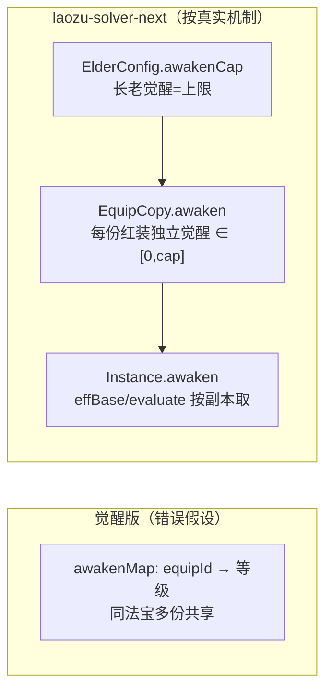

| 影响点 | 觉醒版实现 | 新版实现 |
|---|---|---|
| `evaluate()` 取觉醒等级 | `awakenMap[eq.id]` | `pl[h].inst.awaken`（按副本） |
| `effBase()` self_mult | 按 equipId 查等级 | 按副本查等级（主线程预计算进 eff*，按 uid 索引） |
| 截图识别 | 数字识别存入全局共享 | 数字识别直接落到该格副本 |
| UI 设置 | 求解设置里按法宝设等级 | 长老管理页设上限 cap；已选列表逐副本设实际等级 |
| 表达力 | 无法表达「红A觉醒2 + 红A未觉醒」 | ✅ 可以 |

### 4.2 core/solver —— 求解内核

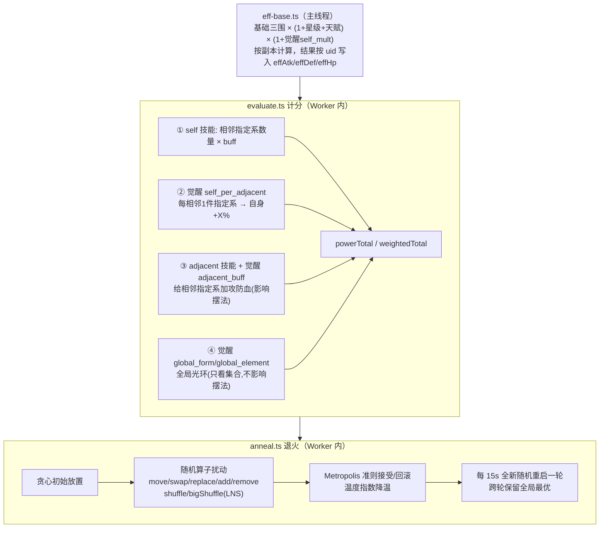

关键数值口径（**逐字段对齐觉醒版，回归测试用**）：
- `FILL_BONUS = 1e7`：强制填满时每格加分
- 温度：`T0 = |初始分| × 0.03 × tempMult`，`T1 = |初始分| × 1e-3 × tempMult`，指数降温
- 算子权重：`move:40 / swap:15 / replace:14 / shuffle:15 / bigShuffle:12 / add:10 / remove:6`
- 星级加成取「≤ 当前星级的最高阈值档」，与天赋加算；觉醒 `self_mult` 单独成乘区，层内多档相加
- 觉醒 `adjacent_buff`：高档替代低档（觉5 的 15% 替代觉3 的 8%，非叠加）
- 觉醒 `global_*`：只取决于已放集合，不影响摆法，但计入得分；本法宝除外

> **对拍前提**：同一红装的所有副本觉醒等级相同时，新版结果应与觉醒版完全一致；副本级差异是新增表达力，单独写用例覆盖。

### 4.3 core/ocr —— 截图识别内核

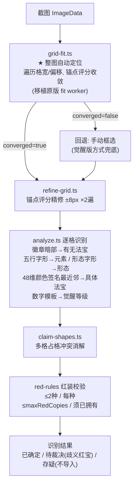

> **与觉醒版的差异**：① `grid-fit.ts` 补回自动定位（觉醒版 `WORKER_SRC` 为空、只能手动框选）；② 红装校验由硬编码「最多2种×2个」改为按长老配置动态校验。其余 analyze/refine/claim 逻辑两版同源，直接抽离。

### 4.4 workers/protocols.ts —— Worker 消息协议（类型化契约）

```typescript
// ---- solver.worker ----
type SolverJobMsg = {
  type: 'solve';
  workerId: number;
  instances: Instance[];
  ctx: SolverContext;
  skillById: Record<number, Skill>;
  awakenDb: AwakenDB;
  attrs: AttrDef[];
  budgetSec: number;
  seed: number;
  tempMult: number;      // 本 Worker 温度倍率（冷热搭配）
};
type SolverOutMsg =
  | { type: 'progress'; workerId: number; iters: number;
      bestScore: number; round: number; snap?: Snapshot[] }  // 有进步才带快照
  | { type: 'done'; workerId: number; bestScore: number;
      bestSnap: Snapshot[]; iters: number; rounds: number }
  | { type: 'error'; workerId: number; message: string };

// ---- fit.worker ----
type FitJobMsg = { type: 'fit'; w: number; h: number; pixels: Uint8ClampedArray };  // transferable
type FitOutMsg =
  | { type: 'done'; grid: Grid; score: number; anchors: number; converged: boolean }
  | { type: 'error'; message: string };
```

### 4.5 services/solver-service.ts —— Worker 池编排（主线程）

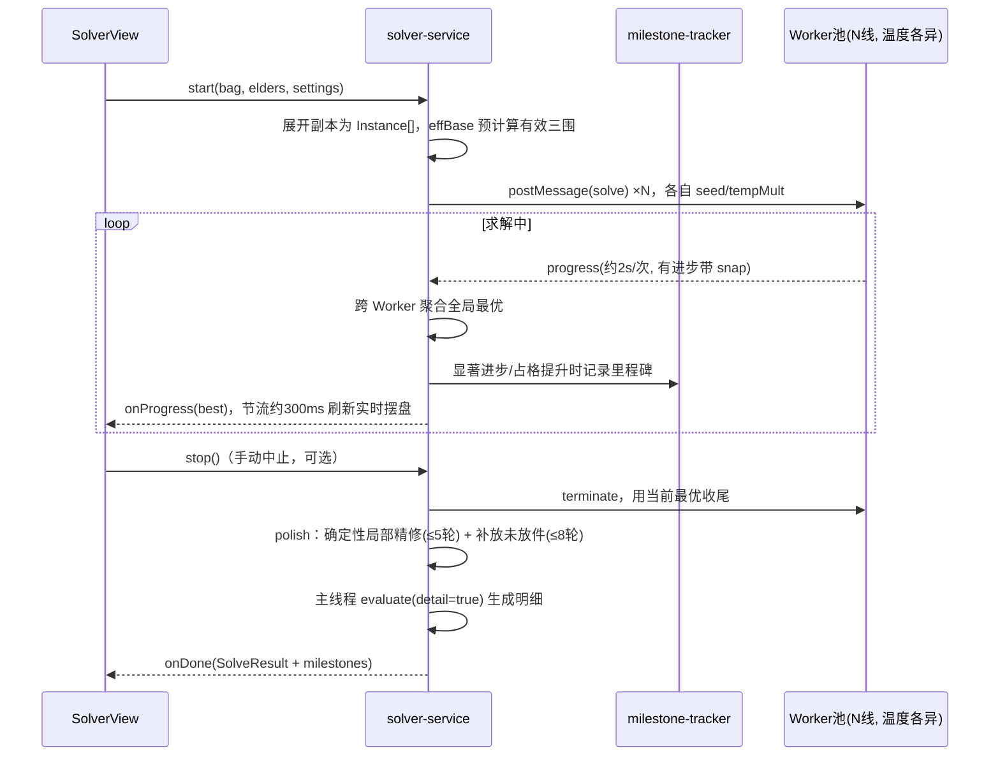

要点：
- Worker 数：默认 `核数-1`（上限 6），可手动 2/3/4/6；温度倍率 ≤3 线用 0.7/1.0/1.6，更多按 0.5~2.5 几何 spread
- **里程碑判定**（对齐原版）：总分显著进步或占格数提升时记录快照
- 主线程刷新节流约 300ms（原版近似即时；觉醒版 800ms 偏钝；做成可调）
- 实时渲染只用快照 + 轻量计分（`detail=false`）；最终结果再算一次带明细的版本

### 4.6 数据提取（scripts/extract-data.mjs）

游戏数据全部来自觉醒版源码中的结构化字面量，用脚本提取，不手工维护：

| 源（觉醒版 `index.html`） | 产物（`core/data/`） | 实测规模 |
|---|---|---|
| `DB`（attrs/skills/talents/shapes/equips） | `game-db.ts` | 375 件法宝 |
| `ELDER_MAP`（equipId → 长老） | `elders.ts`（转为 `Elder[]`，以长老为主键） | 80 位：蓝 16 / 紫 32 / 黄 32 |
| `AWAKEN_DB` | `awaken-db.ts` | 64 件有数据；16 件缺失（13 件蓝长老红装 + 鲲/鲲·剑/共工·剑）；3 件 `maxLevel=3`（大鹏/赤烟驹/哈将） |
| `OCR_DATA.MODEL` / `OT` | `ocr-model.ts` / `signatures.ts` | 48 维签名 |

星级加成表：黄/紫长老 2星+60% / 4星+100% / 5星+150%；蓝长老 2星+40% / 4星+60% / 5星+100%。

提取方式：定位 `const XXX=` 后做括号配平截取字面量，再用 **JSON5 解析**（支持无引号键、注释、尾逗号）——不使用 `eval/new Function` 执行来源代码。产物写入 `core/data/raw/*.json` 并提交入库；`core/data/index.ts` 负责把元组格式转成带类型对象。脚本只在开发者本地运行（`npm run extract-data -- <觉醒版 index.html 路径>`）。

---

## 五、UI 设计（对齐原版）

### 5.1 页面结构

三个页签（hash 路由，GitHub Pages 无需服务端 rewrite）：

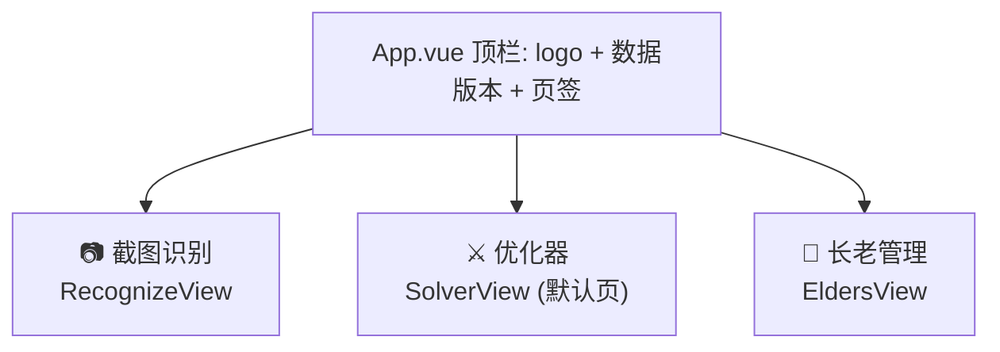

### 5.2 SolverView 优化器页（核心页面，对齐原版分区单页）

原版是**单页五分区**排布（觉醒版拆成了 tab），我们沿用原版：

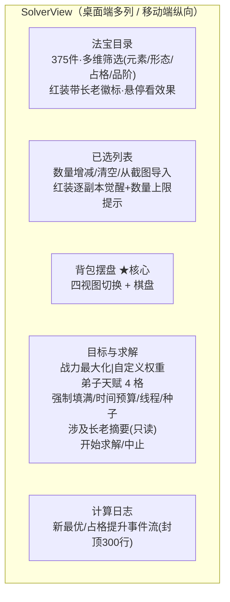

#### 背包摆盘区 —— 四视图（原版设计，完整还原）

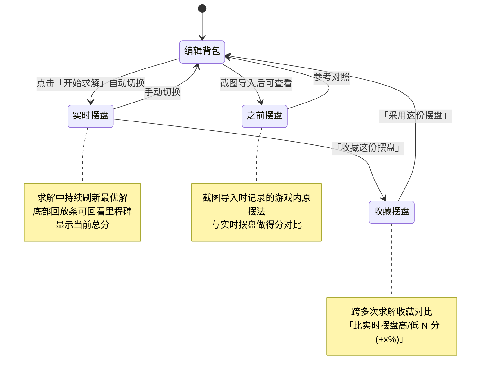

#### 棋盘渲染（BoardGrid）

- 6 行 × 7 列，同一件法宝的多个格子用**同色块+内描边连成整体**（原版用 inset box-shadow 区分同件边界，直接借鉴其 CSS 思路）
- 品阶着色：5红 4黄 3紫 2蓝 1绿；元素角标；锚点格显示法宝名；红装另显觉醒等级
- 桌面端悬停看每件明细（攻防血/buff 来源），移动端点按
- 未开放格以灰色锁标显示；截图识别出的未开放格可一键同步到 `bag.lockedCells`

### 5.3 RecognizeView 截图识别页

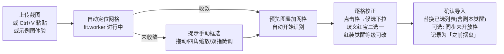

细节：
- 「记住这个法宝的样子」：用户校正后把签名存入本工具的学习库 `laozu-next:ocr-decisions`
- 觉醒等级：右下角数字识别结果直接作为该副本的等级；若超过长老 cap，提示「长老觉醒等级可能需要更新」并提供一键同步
- 红装校验结果（`redWarnings`）在导入前展示，例如「孙悟空未标记拥有」「金箍棒 2 件但孙悟空仅 2 星」
- 识别结果分三区展示：**已确定 N 件 / 待裁决（每组只问一次）/ 存疑（不导入，提示手动补）**

### 5.4 法宝目录：多维筛选与红装长老标注

两版原作只支持元素单维筛选。新版筛选栏 `CatalogFilterBar`：

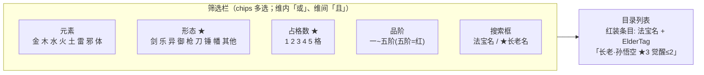

要点：
- **形态筛选**按 `weaponForm`；**占格数筛选**按 `Shape.cellCount`（方便「找小件补空格」）
- **ElderTag 全站复用**：目录、已选列表、识别校正下拉、求解结果明细、棋盘悬停——所有出现红装的地方都带长老名（解决记不住法宝名的问题）
- 搜索命中长老名：搜「孙悟空」直接定位如意金箍棒；列表按拼音排序（`localeCompare('zh-Hans-CN')`，沿用觉醒版）
- 未拥有长老的红装在目录中置灰，添加时提示「先在长老管理中标记拥有」
- 筛选条件存入 settings store，自动保存

### 5.5 长老管理页 EldersView

两版原作把长老星级塞在求解设置里、按装备 ID 散存。新版升级为**账号级独立管理**：

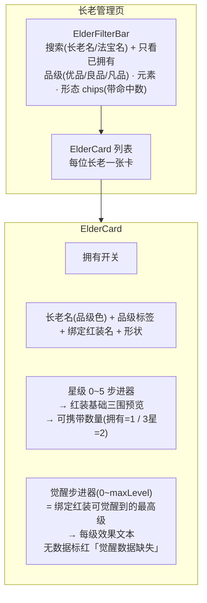

数据流（单一数据源）：

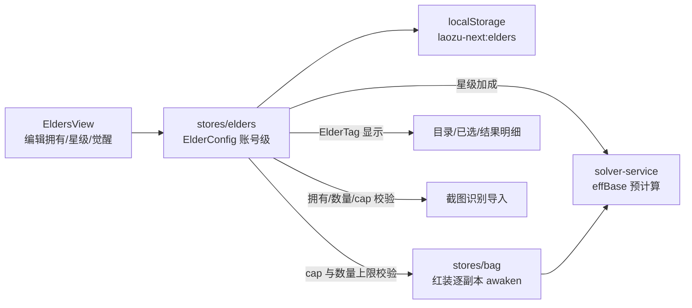

要点：
- **默认账号**：目前只有一个账号（页头显示「账号：默认账号」，不支持切换），默认拥有全部长老、0 星、觉醒 0；取消拥有会显式保存
- **术语**：长老品级用游戏内叫法 优品(4) / 良品(3) / 凡品(2)；长老的「觉醒」就是游戏里长老的觉醒等级，它决定绑定红装每份副本最多能觉醒到几级（代码字段沿用 `awakenCap`）
- **星级与觉醒按长老，红装实际觉醒按副本**：已选列表里新增红装副本时默认等级 = cap，可逐份下调；截图识别的数字直接覆盖
- 下调长老觉醒时，若已选中有副本超过新 cap，自动压到 cap 并在已选列表标黄提示
- 星级下调到 3 星以下且已选中该红装有 2 份时，标红提示超出可携带数量（不自动删除，交给用户决定）
- 无觉醒数据的红装：cap 步进器禁用，按无觉醒计算

### 5.6 移动端适配

- 底部固定「开始求解/中止」栏（原版已有此设计）
- 参数一行排布、标签精简
- 截图识别页：双指开合缩放网格、框内拖动平移
- 长老卡片单列排布，步进器加大触控区域

---

## 六、状态与持久化

### 6.1 Pinia Store 划分

| Store | 职责 | 关键 state |
|---|---|---|
| `bag` | 背包内容 | `selected: SelectedItem[]`（含红装逐副本 awaken）、`lockedCells: number[]`（未开放格）、`previousLayout?: SavedPiece[]`（截图导入的原摆法） |
| `elders` | 账号级长老配置（单一数据源） | `configs: Record<elderId, ElderConfig>`（只存改动过的）；getter：`views`（ElderView[]）、`configMap`（含默认值的完整配置，供求解与红装校验）、`allConfigs` |
| `solver` | 一次求解的生命周期（不持久化） | `running`、`progress`、`best`、`milestones[]`、`log[]`、`result`、`boardMode` |
| `settings` | 求解参数 + 目录筛选 | `target`、`weights{}`、`talents`（弟子天赋 4 格）、`budgetSec`、`threads`、`seed`、`fillAll`、`catalogFilters` |

### 6.2 localStorage 持久化（storage.ts 统一封装）

| key | 内容 | 备注 |
|---|---|---|
| `laozu-next:elders` | 长老配置（拥有/星级/觉醒），账号级；保存全部 80 位的完整配置（默认拥有，未拥有需显式落盘） | 自动保存 |
| `laozu-next:bag` | 已选列表（含副本觉醒）+ 未开放格 + 之前摆盘 | 自动保存 |
| `laozu-next:settings` | 求解设置 + 目录筛选条件 | 自动保存 |
| `laozu-next:saved-boards` | 收藏的摆盘 | |
| `laozu-next:ocr-decisions` | 识别校正学习库 | |

所有值使用 `Persisted<T>` 信封（带 schema 版本）。

### 6.3 导入导出

**约束**：localStorage 按 origin 隔离。原版（`fradwow.github.io`）、觉醒版（`eleven-tz.github.io`）与本工具部署地址是不同 origin，**本工具无法直接读取它们的缓存**。因此：

- **本工具 JSON 导入/导出**：在长老管理页提供「导出备份 / 导入备份」，用于换设备、换浏览器、清缓存前备份。导出包含长老配置、已选列表、求解设置、收藏摆盘四类（识别学习库体积大且可重建，不导出）；导入时可按类勾选，默认只勾长老配置
- **导入校验**：只用 `JSON.parse`，按 schema 校验字段类型与取值范围（星级 0~5、cap ≤ maxLevel、ID 必须存在于数据库），未知字段丢弃，校验失败整体拒绝并提示

### 6.4 账号维度

当前按「一个浏览器 = 一个游戏账号」设计，界面显示为「默认账号」，默认拥有全部长老。若后续需要多账号，在所有 key 前加 profile 前缀（如 `laozu-next:<profile>:elders`），storage.ts 统一处理，业务层无感。

---

## 七、部署架构（GitHub Pages）

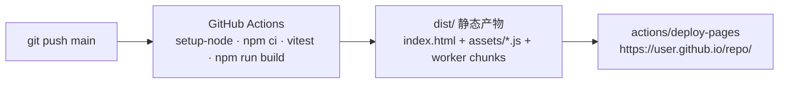

工程要点：
- `vite.config.ts`：`base: '/<repo>/'`（Pages 项目页是子路径托管，必须配置）
- 路由用 **hash 模式**（`/#/elders`），避免 Pages 无 rewrite 规则导致 404
- Worker：Vite 原生支持 `?worker` 导入，产物为独立 chunk
- 用 `actions/deploy-pages` 部署时不经过 Jekyll，无需 `.nojekyll`
- CI 中先跑 `vitest`，失败则不部署
- 本地验证：`npm run dev` / `npm run build && npm run preview`

---

## 八、测试策略（core 层 = 可测性设计的回报）

| 测试 | 内容 | 类比 |
|---|---|---|
| `eff-base.test.ts` | 星级档位取值、天赋加算、觉醒 self_mult 独立乘区、取整口径 | 单元测试 |
| `evaluate.test.ts` | 构造已知摆盘断言总分/单件三围/buff 来源；觉醒 1~5 各级；**同一红装两副本不同觉醒**；adjacent_buff 高档替代低档 | 像给 service 写 JUnit |
| `red-rules.test.ts` | 未拥有=0、1~2星=1、3星及以上=2；种类>2 告警 | 规则测试 |
| 对拍回归 | 同一组输入（所有副本觉醒一致）+ 同 seed，core 结果与觉醒版一致 | 回归基线 |
| `grid-fit.test.ts` / `refine-grid.test.ts` | 用真实截图 fixture 断言网格收敛 | |
| storage 导入校验 | 越界值、未知 ID、畸形 JSON 均被拒绝 | 输入校验测试 |

---

## 九、分期路线图

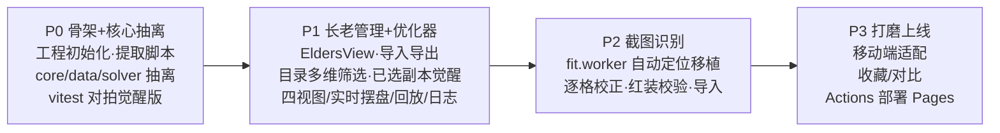

| 阶段 | 交付物 | 验收标准 |
|---|---|---|
| P0 | 可运行的空壳 + 提取脚本 + core 模块 + 单测 | `vitest` 通过；对拍前提下 core 求解结果与觉醒版一致 |
| P1 | 长老管理 + 优化器页可用 | 长老拥有/星级/觉醒可维护并导入导出；目录多维筛选与 ElderTag 可用；已选列表逐副本觉醒正确参与计分；实时摆盘/回放/日志工作 |
| P2 | 识别页可用 | 真实截图自动定位 + 识别，准确率不低于原版；副本觉醒与红装校验正确。**前置：用户提供真实背包截图作为测试 fixture** |
| P3 | 上线 | GitHub Pages 可访问，手机端可用 |

---

## 十、风险与备注

1. **原版 fit worker 是压缩代码**：已用 js-beautify 展开（`laozu-solver/index.beautified.html` 行 1209），变量名为单字母，移植时需要逐段加注释重命名——P2 最大工作量，需配真实截图 fixture 守护。
2. **数据时效**：法宝库 2026-09-23 版本，觉醒数据 2026-09-30/10-11 版本。游戏更新后重跑提取脚本并更新 `version.ts`；收藏摆盘带 `dataVersion`，版本不一致时提示得分可能变化。
3. **数据来源与致谢**：法宝库、颜色签名、退火算法来自原版作者，觉醒数据来自觉醒版作者，README 中致谢两版作者。
4. **觉醒数据缺失**：16 件红装无觉醒数据，UI 标红「觉醒数据缺失，按无觉醒计算」。
5. **不提供旧版数据迁移**：跨 origin 无法读取旧版缓存；觉醒版的觉醒模型（按法宝共享）也与本工具不同。用户在长老管理页直接录入（默认已拥有全部长老，只需调星级与觉醒）。

---

## 附录 A：游戏机制背景（领域模型的设计依据）

> 《我要当老祖》与本工具相关的核心机制，来自玩家实证。修改领域模型前先读本节。

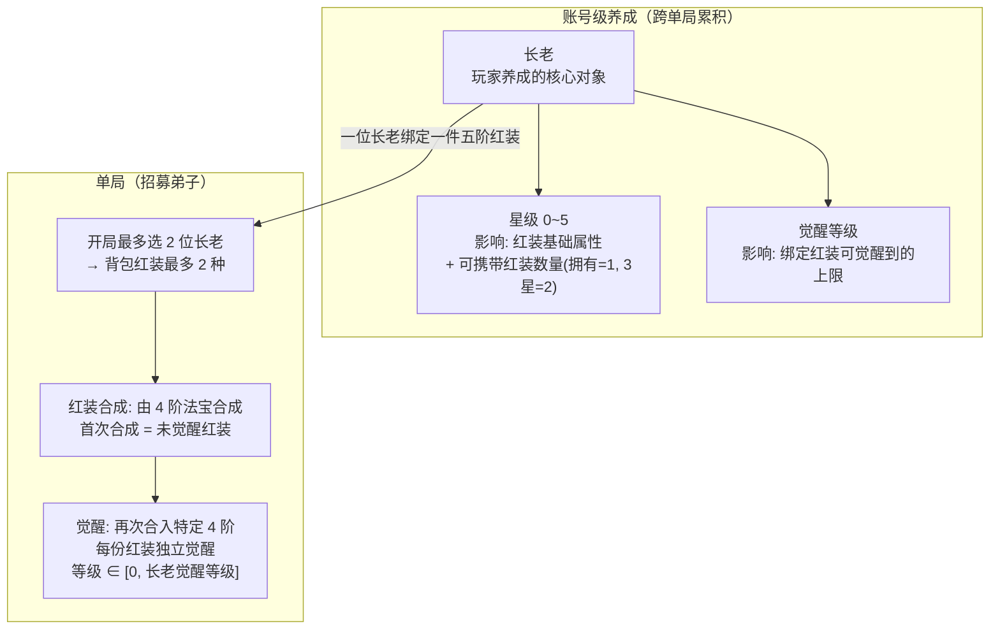

关键推论（直接决定建模）：

| 机制 | 建模决策 |
|---|---|
| 星级属长老，影响红装三围与可携带数量 | `ElderConfig.star`；数量规则 `maxRedCopies()`：未拥有=0，拥有=1，3星=2，上限 2 |
| 长老觉醒等级是上限，不是生效值 | `ElderConfig.awakenCap`，且 ≤ `AwakenEntry.maxLevel` |
| 每份红装独立觉醒（红A觉醒2 与 红A未觉醒 可共存） | `EquipCopy.awaken` / `Instance.awaken` **按副本建模**，觉醒版按 equipId 共享是错的 |
| 单局最多 2 位长老 | 背包红装最多 2 种；与每种 ≤2 件合起来就是原 OCR 写死的「2种×2个」，现改为按配置校验 |
| 觉醒效果向下累积（N 级含 1..N） | `AwakenEntry.levels` 逐档列出，计分时累积；`adjacent_buff` 高档替代低档 |

---

## 附录 B：修订记录

| 版本 | 内容 |
|---|---|
| v1 | 初稿：分层架构、文件结构、UI 对齐原版、部署 |
| v2 | 新增长老管理、目录多维筛选与红装长老标注 |
| v3 | 按游戏机制修正：觉醒按副本、长老觉醒为上限、红装数量规则 |
| v4 | 全文 review：跨 origin 迁移改为导入导出；锁格语义改到格子上；品阶/品质合并；收藏摆盘改为轻量结构；补数据提取章节与实测规模；修正 Mermaid 语法与前后不一致 |
| v5 | 开工前定稿：补弟子天赋设置、Worker 后局部精修（polish）、数据文件改为 raw JSON + index.ts、导出范围定为四类；P2 标注等待真实截图 |
| v6 | P0/P1 实现完成，见附录 C |
| v7 | 长老管理：默认账号默认拥有全部长老；品级改用游戏术语 优品/良品/凡品；新增元素、形态快速筛选；「觉醒上限」改称「觉醒」；移除觉醒版迁移 |
| v8 | P2 开始：真实截图与标准答案；网格自动定位移植完成；普通法宝上的火焰角标按游戏 bug 忽略 |

---

## 附录 C：实现状态

| 阶段 | 状态 | 说明 |
|---|---|---|
| P0 骨架 + 核心抽离 | 完成 | 数据提取、计分、退火、精修；与觉醒版对拍：effBase 全量、evaluate 200 组随机摆盘逐项相等、退火在假时钟下逐位一致 |
| P1 长老管理 + 优化器 | 完成 | 长老管理（默认账号、品级/元素/形态筛选、备份导入导出）、目录多维筛选、逐副本觉醒、四视图棋盘、实时摆盘/回放、收藏 |
| P2 截图识别 | 进行中 | 已有 4 张真实截图（局外 3 + 游历中 1）与标准答案 `tests/fixtures/ocr/manifest.json`；网格自动定位已移植（`core/ocr/fit.ts`），4 张全部定位成功、误差 < 格宽 3%；调试脚本 `scripts/ocr-debug.ts` 输出网格叠加图。待做：逐格识别（元素/形态/品阶/觉醒角标）、法宝匹配、识别页 UI |
| P3 上线 | 部分 | Actions 部署流程已就绪；移动端基础适配已做 |

与设计的差异：
- 求解 Worker 不打包游戏数据，计分所需的技能/觉醒/属性表随 job 消息传入（Worker chunk 约 9 KB）
- 退火时钟通过参数注入（生产用 `performance.now`），便于确定性测试与对拍
- 觉醒版数据中个别红装某一级觉醒为空（大鹏/赤烟驹/哈将的觉2），界面显示「无新增效果」
